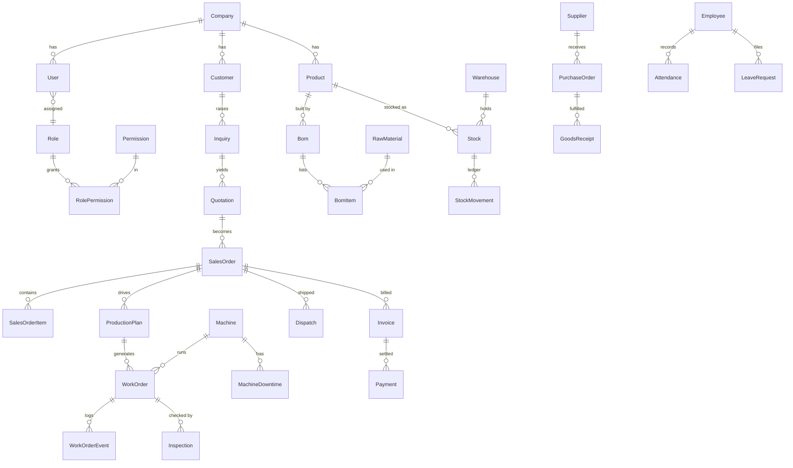

# Database Schema — TechForge ERP + MES

**DB:** PostgreSQL 15+ · **ORM:** Prisma · **Tenancy:** every business table carries `companyId`.

## Design principles
- **Normalized (3NF)** master data; **append-only ledgers** for stock and payments (never mutate history).
- **Money** stored as `Decimal(14,2)`; **quantities** as `Decimal(14,4)` (supports fractional UoM).
- Soft-delete via `deletedAt` on master data; hard delete never used for transactional records.
- All state fields are Prisma `enum`s → DB-level integrity.
- `@@index` on every foreign key and on hot filter columns (`companyId`, `status`, `createdAt`).

## Entity groups
1. **Tenancy & Auth:** Company, User, Role, Permission, RolePermission, RefreshToken
2. **Master data:** Customer, Supplier, Warehouse, Product, RawMaterial, Bom, BomItem
3. **Inventory ledger:** Stock, StockMovement
4. **Sales:** Inquiry, InquiryItem, Quotation, QuotationItem, SalesOrder, SalesOrderItem
5. **Production/MES:** ProductionPlan, PlanMaterialDemand, WorkOrder, WorkOrderEvent, Machine, MachineDowntime, MaintenanceOrder
6. **Quality:** Inspection, InspectionResult, NonConformance
7. **Purchasing:** PurchaseOrder, PurchaseOrderItem, GoodsReceipt, GoodsReceiptItem
8. **Dispatch & Finance:** Dispatch, DispatchItem, Invoice, InvoiceItem, Payment
9. **HR:** Employee, Attendance, LeaveRequest
10. **Platform:** Notification, ActivityLog, Document, AiConversation, AiMessage

---

## ER overview (Mermaid)



---

## Prisma schema (draft — `apps/api/prisma/schema.prisma`)

```prisma
generator client {
  provider = "prisma-client-js"
}

datasource db {
  provider = "postgresql"
  url      = env("DATABASE_URL")
}

/// ────────────────────────── Tenancy & Auth ──────────────────────────
model Company {
  id        String   @id @default(cuid())
  name      String
  legalName String?
  taxId     String?
  currency  String   @default("INR")
  timezone  String   @default("Asia/Kolkata")
  logoUrl   String?
  createdAt DateTime @default(now())
  updatedAt DateTime @updatedAt

  users     User[]
  customers Customer[]
  suppliers Supplier[]
  products  Product[]
  // …all business relations back-reference Company
}

model User {
  id           String    @id @default(cuid())
  companyId    String
  company      Company   @relation(fields: [companyId], references: [id])
  email        String
  passwordHash String
  firstName    String
  lastName     String
  roleId       String
  role         Role      @relation(fields: [roleId], references: [id])
  isActive     Boolean   @default(true)
  lastLoginAt  DateTime?
  employee     Employee?
  createdAt    DateTime  @default(now())
  updatedAt    DateTime  @updatedAt
  deletedAt    DateTime?

  refreshTokens RefreshToken[]
  activities    ActivityLog[]

  @@unique([companyId, email])
  @@index([companyId])
}

model Role {
  id          String  @id @default(cuid())
  companyId   String
  name        String  // ADMIN, PRODUCTION_MANAGER, …
  description String?
  isSystem    Boolean @default(false)
  users       User[]
  permissions RolePermission[]

  @@unique([companyId, name])
}

model Permission {
  id       String @id @default(cuid())
  resource String // order, production, quality, inventory, finance…
  action   String // read, create, update, delete, approve, release…
  key      String @unique // "order:read"
  roles    RolePermission[]
}

model RolePermission {
  roleId       String
  permissionId String
  role         Role       @relation(fields: [roleId], references: [id])
  permission   Permission @relation(fields: [permissionId], references: [id])
  @@id([roleId, permissionId])
}

model RefreshToken {
  id         String   @id @default(cuid())
  userId     String
  user       User     @relation(fields: [userId], references: [id])
  tokenHash  String
  expiresAt  DateTime
  revokedAt  DateTime?
  createdAt  DateTime @default(now())
  @@index([userId])
}

/// ────────────────────────── Master data ──────────────────────────
model Customer {
  id           String   @id @default(cuid())
  companyId    String
  company      Company  @relation(fields: [companyId], references: [id])
  code         String
  name         String
  email        String?
  phone        String?
  taxId        String?
  creditLimit  Decimal  @default(0) @db.Decimal(14, 2)
  billingAddr  Json?
  shippingAddr Json?
  isActive     Boolean  @default(true)
  createdAt    DateTime @default(now())
  updatedAt    DateTime @updatedAt
  deletedAt    DateTime?
  inquiries    Inquiry[]
  salesOrders  SalesOrder[]
  @@unique([companyId, code])
  @@index([companyId])
}

model Supplier {
  id             String   @id @default(cuid())
  companyId      String
  company        Company  @relation(fields: [companyId], references: [id])
  code           String
  name           String
  email          String?
  phone          String?
  paymentTerms   String?
  leadTimeDays   Int      @default(7)
  rating         Decimal? @db.Decimal(3, 2)
  isActive       Boolean  @default(true)
  purchaseOrders PurchaseOrder[]
  @@unique([companyId, code])
  @@index([companyId])
}

model Warehouse {
  id        String  @id @default(cuid())
  companyId String
  code      String
  name      String
  location  String?
  stocks    Stock[]
  @@unique([companyId, code])
}

enum ItemType { PRODUCT RAW_MATERIAL }

model Product {
  id          String   @id @default(cuid())
  companyId   String
  company     Company  @relation(fields: [companyId], references: [id])
  sku         String
  name        String
  description String?
  category    String?
  uom         String   @default("PCS")
  unitPrice   Decimal  @default(0) @db.Decimal(14, 2)
  barcode     String?
  specs       Json?
  isActive    Boolean  @default(true)
  createdAt   DateTime @default(now())
  updatedAt   DateTime @updatedAt
  deletedAt   DateTime?
  boms        Bom[]
  stocks      Stock[]
  @@unique([companyId, sku])
  @@index([companyId])
}

model RawMaterial {
  id            String   @id @default(cuid())
  companyId     String
  sku           String
  name          String
  uom           String   @default("PCS")
  reorderPoint  Decimal  @default(0) @db.Decimal(14, 4)
  safetyStock   Decimal  @default(0) @db.Decimal(14, 4)
  unitCost      Decimal  @default(0) @db.Decimal(14, 2)
  defaultSupplierId String?
  stocks        Stock[]
  bomItems      BomItem[]
  @@unique([companyId, sku])
  @@index([companyId])
}

model Bom {
  id        String    @id @default(cuid())
  companyId String
  productId String
  product   Product   @relation(fields: [productId], references: [id])
  version   Int       @default(1)
  isActive  Boolean   @default(true)
  items     BomItem[]
  @@unique([productId, version])
}

model BomItem {
  id            String      @id @default(cuid())
  bomId         String
  bom           Bom         @relation(fields: [bomId], references: [id])
  rawMaterialId String
  rawMaterial   RawMaterial @relation(fields: [rawMaterialId], references: [id])
  quantity      Decimal     @db.Decimal(14, 4)
  scrapPercent  Decimal     @default(0) @db.Decimal(5, 2)
  @@index([bomId])
}

/// ────────────────────────── Inventory ledger ──────────────────────────
model Stock {
  id            String   @id @default(cuid())
  companyId     String
  warehouseId   String
  warehouse     Warehouse @relation(fields: [warehouseId], references: [id])
  itemType      ItemType
  productId     String?
  product       Product?     @relation(fields: [productId], references: [id])
  rawMaterialId String?
  rawMaterial   RawMaterial? @relation(fields: [rawMaterialId], references: [id])
  onHand        Decimal  @default(0) @db.Decimal(14, 4)
  reserved      Decimal  @default(0) @db.Decimal(14, 4)
  // available = onHand - reserved (computed in service)
  movements     StockMovement[]
  updatedAt     DateTime @updatedAt
  @@index([companyId, itemType])
}

enum MovementType { RECEIPT ISSUE TRANSFER ADJUSTMENT PRODUCTION_IN SCRAP RESERVE UNRESERVE }

model StockMovement {
  id          String       @id @default(cuid())
  companyId   String
  stockId     String
  stock       Stock        @relation(fields: [stockId], references: [id])
  type        MovementType
  quantity    Decimal      @db.Decimal(14, 4) // signed
  refType     String?      // "WorkOrder", "GoodsReceipt", "Dispatch"…
  refId       String?
  note        String?
  createdById String?
  createdAt   DateTime     @default(now())
  @@index([companyId, type])
  @@index([stockId])
}

/// ────────────────────────── Sales ──────────────────────────
enum QuotationStatus { DRAFT SENT ACCEPTED REJECTED EXPIRED }
enum SalesOrderStatus { CONFIRMED IN_PRODUCTION READY DISPATCHED INVOICED CLOSED CANCELLED }

model Inquiry {
  id         String   @id @default(cuid())
  companyId  String
  number     String
  customerId String
  customer   Customer @relation(fields: [customerId], references: [id])
  neededBy   DateTime?
  notes      String?
  status     String   @default("OPEN")
  items      InquiryItem[]
  quotations Quotation[]
  createdAt  DateTime @default(now())
  @@unique([companyId, number])
}

model InquiryItem {
  id        String  @id @default(cuid())
  inquiryId String
  inquiry   Inquiry @relation(fields: [inquiryId], references: [id])
  productId String
  quantity  Decimal @db.Decimal(14, 4)
}

model Quotation {
  id         String          @id @default(cuid())
  companyId  String
  number     String
  inquiryId  String?
  inquiry    Inquiry?        @relation(fields: [inquiryId], references: [id])
  customerId String
  status     QuotationStatus @default(DRAFT)
  validUntil DateTime?
  subtotal   Decimal         @default(0) @db.Decimal(14, 2)
  taxTotal   Decimal         @default(0) @db.Decimal(14, 2)
  grandTotal Decimal         @default(0) @db.Decimal(14, 2)
  items      QuotationItem[]
  salesOrder SalesOrder?
  createdAt  DateTime        @default(now())
  @@unique([companyId, number])
}

model QuotationItem {
  id          String    @id @default(cuid())
  quotationId String
  quotation   Quotation @relation(fields: [quotationId], references: [id])
  productId   String
  quantity    Decimal   @db.Decimal(14, 4)
  unitPrice   Decimal   @db.Decimal(14, 2)
  taxPercent  Decimal   @default(0) @db.Decimal(5, 2)
  lineTotal   Decimal   @db.Decimal(14, 2)
}

model SalesOrder {
  id          String           @id @default(cuid())
  companyId   String
  number      String
  customerId  String
  customer    Customer         @relation(fields: [customerId], references: [id])
  quotationId String?          @unique
  quotation   Quotation?       @relation(fields: [quotationId], references: [id])
  status      SalesOrderStatus @default(CONFIRMED)
  orderDate   DateTime         @default(now())
  promisedDate DateTime?
  grandTotal  Decimal          @default(0) @db.Decimal(14, 2)
  items       SalesOrderItem[]
  plans       ProductionPlan[]
  dispatches  Dispatch[]
  invoices    Invoice[]
  @@unique([companyId, number])
  @@index([companyId, status])
}

model SalesOrderItem {
  id           String     @id @default(cuid())
  salesOrderId String
  salesOrder   SalesOrder @relation(fields: [salesOrderId], references: [id])
  productId    String
  quantity     Decimal    @db.Decimal(14, 4)
  unitPrice    Decimal    @db.Decimal(14, 2)
  lineTotal    Decimal    @db.Decimal(14, 2)
}

/// ────────────────────────── Production / MES ──────────────────────────
enum WorkOrderStatus { PLANNED RELEASED IN_PROGRESS PAUSED COMPLETED CLOSED CANCELLED }
enum MachineStatus { RUNNING IDLE DOWN MAINTENANCE SETUP }
enum WorkOrderEventType { START PAUSE RESUME OUTPUT STOP COMPLETE }

model ProductionPlan {
  id           String   @id @default(cuid())
  companyId    String
  number       String
  salesOrderId String?
  salesOrder   SalesOrder? @relation(fields: [salesOrderId], references: [id])
  status       String   @default("DRAFT") // DRAFT, MATERIAL_CHECKED, RELEASED
  plannedStart DateTime?
  plannedEnd   DateTime?
  demands      PlanMaterialDemand[]
  workOrders   WorkOrder[]
  createdAt    DateTime @default(now())
  @@unique([companyId, number])
}

model PlanMaterialDemand {
  id            String   @id @default(cuid())
  planId        String
  plan          ProductionPlan @relation(fields: [planId], references: [id])
  rawMaterialId String
  required      Decimal  @db.Decimal(14, 4)
  available     Decimal  @db.Decimal(14, 4)
  shortfall     Decimal  @db.Decimal(14, 4)
}

model WorkOrder {
  id           String          @id @default(cuid())
  companyId    String
  number       String
  planId       String?
  plan         ProductionPlan? @relation(fields: [planId], references: [id])
  productId    String
  quantity     Decimal         @db.Decimal(14, 4)
  producedGood Decimal         @default(0) @db.Decimal(14, 4)
  producedReject Decimal       @default(0) @db.Decimal(14, 4)
  machineId    String?
  machine      Machine?        @relation(fields: [machineId], references: [id])
  operatorId   String?
  status       WorkOrderStatus @default(PLANNED)
  plannedStart DateTime?
  plannedEnd   DateTime?
  actualStart  DateTime?
  actualEnd    DateTime?
  events       WorkOrderEvent[]
  inspections  Inspection[]
  createdAt    DateTime        @default(now())
  @@unique([companyId, number])
  @@index([companyId, status])
}

model WorkOrderEvent {
  id          String            @id @default(cuid())
  workOrderId String
  workOrder   WorkOrder         @relation(fields: [workOrderId], references: [id])
  type        WorkOrderEventType
  quantityGood Decimal?         @db.Decimal(14, 4)
  quantityReject Decimal?       @db.Decimal(14, 4)
  reasonCode  String?
  operatorId  String?
  at          DateTime          @default(now())
  @@index([workOrderId])
}

model Machine {
  id         String   @id @default(cuid())
  companyId  String
  code       String
  name       String
  type       String?
  location   String?
  capacityPerHour Decimal? @db.Decimal(14, 4)
  status     MachineStatus @default(IDLE)
  workOrders WorkOrder[]
  downtimes  MachineDowntime[]
  maintenance MaintenanceOrder[]
  @@unique([companyId, code])
}

model MachineDowntime {
  id         String   @id @default(cuid())
  companyId  String
  machineId  String
  machine    Machine  @relation(fields: [machineId], references: [id])
  reasonCode String   // BREAKDOWN, SETUP, NO_MATERIAL, PLANNED, QUALITY
  startAt    DateTime
  endAt      DateTime?
  minutes    Int?     // computed on close
  note       String?
  @@index([companyId, machineId])
}

enum MaintenanceType { PREVENTIVE BREAKDOWN }
model MaintenanceOrder {
  id         String   @id @default(cuid())
  companyId  String
  machineId  String
  machine    Machine  @relation(fields: [machineId], references: [id])
  type       MaintenanceType
  status     String   @default("OPEN") // OPEN, IN_PROGRESS, DONE
  scheduledAt DateTime?
  completedAt DateTime?
  notes      String?
}

/// ────────────────────────── Quality ──────────────────────────
enum InspectionStage { INCOMING IN_PROCESS FINAL }
enum InspectionStatus { PENDING IN_PROGRESS PASSED FAILED }

model Inspection {
  id          String           @id @default(cuid())
  companyId   String
  number      String
  stage       InspectionStage
  workOrderId String?
  workOrder   WorkOrder?       @relation(fields: [workOrderId], references: [id])
  goodsReceiptId String?
  sampleSize  Int              @default(1)
  passedQty   Decimal          @default(0) @db.Decimal(14, 4)
  rejectedQty Decimal          @default(0) @db.Decimal(14, 4)
  status      InspectionStatus @default(PENDING)
  inspectorId String?
  results     InspectionResult[]
  ncr         NonConformance?
  createdAt   DateTime         @default(now())
  @@unique([companyId, number])
}

model InspectionResult {
  id           String     @id @default(cuid())
  inspectionId String
  inspection   Inspection @relation(fields: [inspectionId], references: [id])
  parameter    String
  expected     String?
  measured     String?
  pass         Boolean
}

model NonConformance {
  id           String     @id @default(cuid())
  companyId    String
  inspectionId String     @unique
  inspection   Inspection @relation(fields: [inspectionId], references: [id])
  disposition  String?    // REWORK, SCRAP, ACCEPT
  status       String     @default("OPEN")
  notes        String?
}

/// ────────────────────────── Purchasing ──────────────────────────
enum PurchaseOrderStatus { DRAFT SENT PARTIALLY_RECEIVED RECEIVED CLOSED CANCELLED }

model PurchaseOrder {
  id         String              @id @default(cuid())
  companyId  String
  number     String
  supplierId String
  supplier   Supplier            @relation(fields: [supplierId], references: [id])
  status     PurchaseOrderStatus @default(DRAFT)
  orderDate  DateTime            @default(now())
  expectedDate DateTime?
  grandTotal Decimal             @default(0) @db.Decimal(14, 2)
  items      PurchaseOrderItem[]
  receipts   GoodsReceipt[]
  @@unique([companyId, number])
  @@index([companyId, status])
}

model PurchaseOrderItem {
  id              String        @id @default(cuid())
  purchaseOrderId String
  purchaseOrder   PurchaseOrder @relation(fields: [purchaseOrderId], references: [id])
  rawMaterialId   String
  quantity        Decimal       @db.Decimal(14, 4)
  receivedQty     Decimal       @default(0) @db.Decimal(14, 4)
  unitCost        Decimal       @db.Decimal(14, 2)
  lineTotal       Decimal       @db.Decimal(14, 2)
}

model GoodsReceipt {
  id              String        @id @default(cuid())
  companyId       String
  number          String
  purchaseOrderId String
  purchaseOrder   PurchaseOrder @relation(fields: [purchaseOrderId], references: [id])
  receivedAt      DateTime      @default(now())
  items           GoodsReceiptItem[]
  @@unique([companyId, number])
}

model GoodsReceiptItem {
  id             String       @id @default(cuid())
  goodsReceiptId String
  goodsReceipt   GoodsReceipt @relation(fields: [goodsReceiptId], references: [id])
  rawMaterialId  String
  quantity       Decimal      @db.Decimal(14, 4)
}

/// ────────────────────────── Dispatch & Finance ──────────────────────────
enum InvoiceStatus { DRAFT ISSUED PARTIALLY_PAID PAID OVERDUE CANCELLED }

model Dispatch {
  id           String   @id @default(cuid())
  companyId    String
  number       String
  salesOrderId String
  salesOrder   SalesOrder @relation(fields: [salesOrderId], references: [id])
  dispatchedAt DateTime @default(now())
  carrier      String?
  trackingNo   String?
  items        DispatchItem[]
  @@unique([companyId, number])
}

model DispatchItem {
  id         String   @id @default(cuid())
  dispatchId String
  dispatch   Dispatch @relation(fields: [dispatchId], references: [id])
  productId  String
  quantity   Decimal  @db.Decimal(14, 4)
}

model Invoice {
  id           String        @id @default(cuid())
  companyId    String
  number       String
  salesOrderId String
  salesOrder   SalesOrder    @relation(fields: [salesOrderId], references: [id])
  status       InvoiceStatus @default(DRAFT)
  issueDate    DateTime?
  dueDate      DateTime?
  subtotal     Decimal       @default(0) @db.Decimal(14, 2)
  taxTotal     Decimal       @default(0) @db.Decimal(14, 2)
  grandTotal   Decimal       @default(0) @db.Decimal(14, 2)
  paidTotal    Decimal       @default(0) @db.Decimal(14, 2)
  items        InvoiceItem[]
  payments     Payment[]
  @@unique([companyId, number])
  @@index([companyId, status])
}

model InvoiceItem {
  id         String  @id @default(cuid())
  invoiceId  String
  invoice    Invoice @relation(fields: [invoiceId], references: [id])
  productId  String
  quantity   Decimal @db.Decimal(14, 4)
  unitPrice  Decimal @db.Decimal(14, 2)
  taxPercent Decimal @default(0) @db.Decimal(5, 2)
  lineTotal  Decimal @db.Decimal(14, 2)
}

model Payment {
  id        String   @id @default(cuid())
  companyId String
  invoiceId String
  invoice   Invoice  @relation(fields: [invoiceId], references: [id])
  amount    Decimal  @db.Decimal(14, 2)
  method    String   // CASH, BANK, UPI, CARD
  paidAt    DateTime @default(now())
  reference String?
  @@index([invoiceId])
}

/// ────────────────────────── HR ──────────────────────────
model Employee {
  id           String   @id @default(cuid())
  companyId    String
  code         String
  firstName    String
  lastName     String
  department   String?
  designation  String?
  shift        String?
  userId       String?  @unique
  user         User?    @relation(fields: [userId], references: [id])
  attendance   Attendance[]
  leaves       LeaveRequest[]
  @@unique([companyId, code])
}

model Attendance {
  id         String   @id @default(cuid())
  companyId  String
  employeeId String
  employee   Employee @relation(fields: [employeeId], references: [id])
  date       DateTime @db.Date
  checkIn    DateTime?
  checkOut   DateTime?
  status     String   @default("PRESENT") // PRESENT, ABSENT, LEAVE, HALF_DAY
  @@unique([employeeId, date])
}

model LeaveRequest {
  id         String   @id @default(cuid())
  companyId  String
  employeeId String
  employee   Employee @relation(fields: [employeeId], references: [id])
  type       String   // CASUAL, SICK, EARNED
  fromDate   DateTime @db.Date
  toDate     DateTime @db.Date
  status     String   @default("PENDING") // PENDING, APPROVED, REJECTED
  reason     String?
  approverId String?
}

/// ────────────────────────── Platform ──────────────────────────
model Notification {
  id        String   @id @default(cuid())
  companyId String
  userId    String?  // null = broadcast to role/company
  type      String
  title     String
  body      String?
  data      Json?
  readAt    DateTime?
  createdAt DateTime @default(now())
  @@index([companyId, userId])
}

model ActivityLog {
  id         String   @id @default(cuid())
  companyId  String
  userId     String?
  user       User?    @relation(fields: [userId], references: [id])
  action     String   // CREATE, UPDATE, DELETE, STATE_CHANGE, LOGIN
  entityType String
  entityId   String?
  before     Json?
  after      Json?
  ip         String?
  createdAt  DateTime @default(now())
  @@index([companyId, entityType])
}

model Document {
  id         String   @id @default(cuid())
  companyId  String
  entityType String
  entityId   String
  fileName   String
  mimeType   String
  size       Int
  storageKey String   // path (local) or S3 key
  uploadedById String?
  createdAt  DateTime @default(now())
  @@index([companyId, entityType, entityId])
}

model AiConversation {
  id        String   @id @default(cuid())
  companyId String
  userId    String
  title     String?
  createdAt DateTime @default(now())
  messages  AiMessage[]
}

model AiMessage {
  id             String   @id @default(cuid())
  conversationId String
  conversation   AiConversation @relation(fields: [conversationId], references: [id])
  role           String   // user, assistant, tool
  content        String
  toolCalls      Json?    // tool name + args + result summary
  createdAt      DateTime @default(now())
}
```

> **Note:** back-reference relation fields on `Company` are abbreviated above for readability; the real schema lists each. Prisma requires both sides of every relation.

## Seed plan (`prisma/seed.ts`)
1 company (TechForge) · 9 roles + full permission matrix · 1 admin + 1 user per role · 8 machines · 3 warehouses · ~20 products with BOMs · ~30 raw materials · 10 customers · 6 suppliers · 60 days of historical work orders, downtime, inspections, invoices, attendance → so **every dashboard/report/AI query has real data on first run**.
